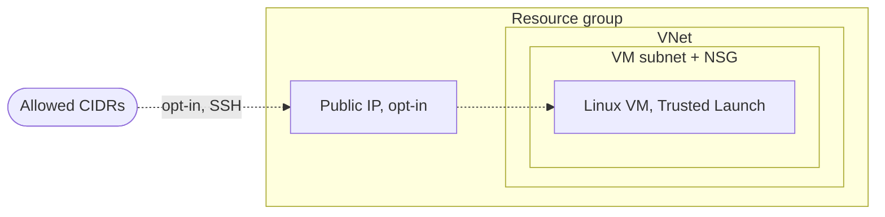

# Azure Simple VM

A single Linux VM. A public IP is optional and off by default.

OpenTofu demo template. Standalone, no dependency on other repos. Compatible with Terraform.

## Architecture



- Resource group
- VNet with one subnet (default outbound access disabled) and an NSG
- Linux VM (Ubuntu 24.04 LTS, Trusted Launch) with a NIC and a system-assigned managed identity
- Standard public IP (only when `enable_public_ip = true`)

## Security

- SSH key only, password login disabled
- Trusted Launch: Secure Boot and vTPM enabled
- Managed disks encrypted at rest with platform-managed keys. Encryption at host is optional (`encryption_at_host_enabled`)
- VM extensions disabled
- Default: no public IP, no inbound NSG rules, no default outbound internet access
- Public IP only on opt-in. Inbound traffic is limited to `allowed_ingress_cidrs` and `allowed_ingress_ports`, by default port 22 from `0.0.0.0/0`. Limit the CIDRs for anything beyond a short demo

Accepted checkov findings (documented inline in the code):

| Check | Reason |
|---|---|
| CKV_AZURE_119, CKV2_AZURE_39 | Public IP is opt-in and limited to allowed CIDRs |

## Usage

Sign in with `az login` and set `ARM_SUBSCRIPTION_ID` to the target subscription.

```bash
cp terraform.tfvars.example terraform.tfvars
tofu init
tofu plan
tofu apply
```

## Access

Without a public IP, connect through Azure Bastion (not part of this template) or from inside the VNet.
The VM has no default outbound internet access, so package updates need a NAT gateway or a public IP.

With `advanced_settings.enable_public_ip = true`, SSH from an allowed CIDR:

```bash
ssh azureuser@<public_ip>
```


## Inputs

| Name | Description | Default |
|---|---|---|
| `name_prefix` | Prefix for all resource names | `"demo"` |
| `location` | Azure location | `"germanywestcentral"` |
| `ssh_public_key` | SSH public key for the admin user (required) | none |
| `vm_size` | VM size, must support Trusted Launch | `"Standard_B2s_v2"` |
| `advanced_settings` | Object with the settings below, all optional | `{}` |

`advanced_settings` attributes (shown as "Advanced Settings" in the StackGuardian form):

| Name | Description | Default |
|---|---|---|
| `vnet_cidr` | Address space of the VNet | `"10.0.0.0/16"` |
| `admin_username` | Admin user | `"azureuser"` |
| `enable_public_ip` | Attach a Standard public IP | `false` |
| `allowed_ingress_cidrs` | Allowed source CIDRs, at least one with a public IP | `["0.0.0.0/0"]` |
| `allowed_ingress_ports` | Opened TCP ports | `[22]` |
| `encryption_at_host_enabled` | Encryption at host (needs the subscription feature) | `false` |
| `tags` | Additional tags for all resources | `{}` |

## Outputs

| Name | Description |
|---|---|
| `resource_group_name` | Name of the resource group |
| `vm_name` | Name of the VM |
| `vm_id` | ID of the VM |
| `private_ip` | Private IP |
| `public_ip` | Public IP, `null` if disabled |
| `ssh_command` | SSH command, `null` unless the public IP is enabled |

## Cost

The VM is billed hourly. A Standard public IP is billed while it exists.

**Destroy after the demo:**

```bash
tofu destroy
```

## Tests

The GitLab pipeline (`.gitlab-ci.yml`) lints every push. Merge requests into `development` or `main` also run
validation, the checkov scan and the unit tests. A tag runs all of these plus the integration tests, which deploy
real resources and destroy them again, and then creates a release. Integration tests run only when the CI/CD variables `AZURE_CLIENT_ID`, `AZURE_TENANT_ID` and `AZURE_SUBSCRIPTION_ID` are set: an app registration with a federated credential for GitLab OIDC and the audience `api://AzureADTokenExchange`.

```bash
tofu test -test-directory=tests/unit
```

Test cases: [tests/README.md](tests/README.md)

## Development

```bash
pre-commit install
pre-commit run --all-files
```
